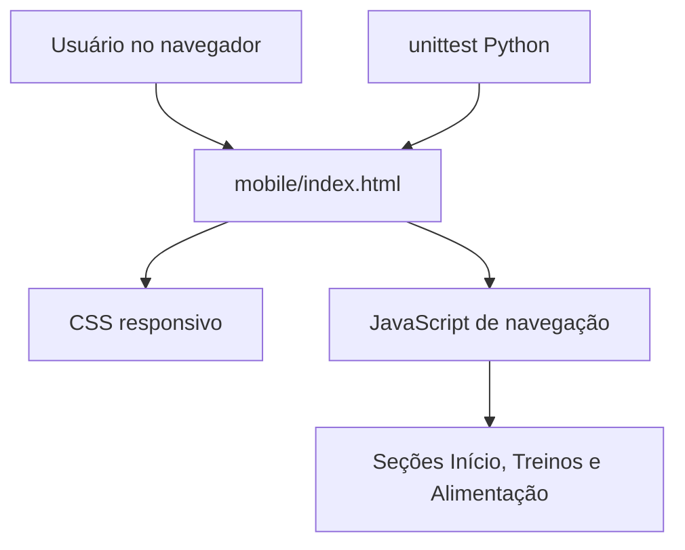

# Documentação técnica — Sprint 9

## Escopo e confiabilidade
Este documento cobre **somente os artefatos da Sprint 9 verificados nesta branch**. Não foi possível recuperar a árvore nem os arquivos do aplicativo principal com o acesso de leitura disponível. Portanto, **não é correto afirmar** quais frameworks, tabelas, endpoints ou relacionamentos o projeto principal possui.

## Componentes verificados
- `sprint9/mobile/index.html`: protótipo responsivo, com três seções (início, treinos, alimentação), CSS e navegação client-side; não tem backend.
- `sprint9/testes/test_mobile.py`: testes unitários em Python (biblioteca padrão) que inspecionam estrutura e requisitos básicos do protótipo.
- `sprint9/TAREFAS_INDEPENDENTES.md`: planejamento da sprint.

## Arquitetura do protótipo

## Persistência e banco de dados
O protótipo mobile **não utiliza banco de dados**. Não existe diagrama entidade-relacionamento verificável para este protótipo. As informações exibidas são exemplos estáticos. Um diagrama do banco do projeto principal exige leitura do esquema/migrações reais.

## Como validar
1. Abrir `sprint9/mobile/index.html` no navegador.
2. Testar os três botões da navegação em tela pequena e grande.
3. Executar `python -m unittest discover -s sprint9/testes -v` na raiz do repositório.

## Pendências para documentar o aplicativo principal
- [ ] Identificar árvore de diretórios, linguagem e framework reais.
- [ ] Inspecionar modelos, migrações e esquema do banco, se houver.
- [ ] Elaborar diagrama de entidades com chaves e relacionamentos comprovados.
- [ ] Descrever autenticação, serviços, APIs e implantação com base no código.
- [ ] Executar testes reais e registrar resultados.

**Status:** documentação do protótipo concluída; documentação da arquitetura completa do aplicativo pendente de inspeção.
